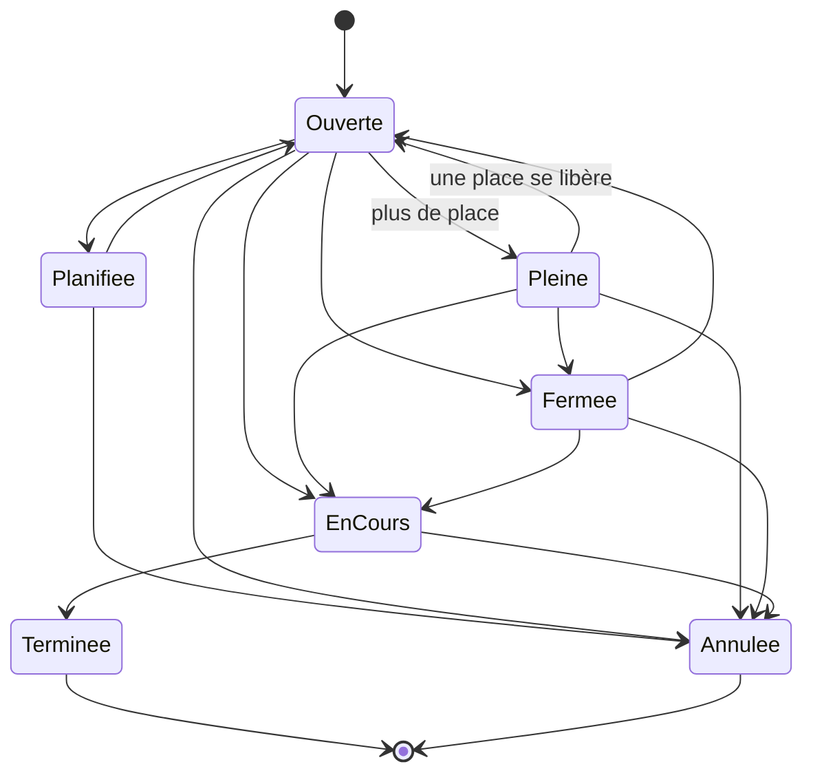
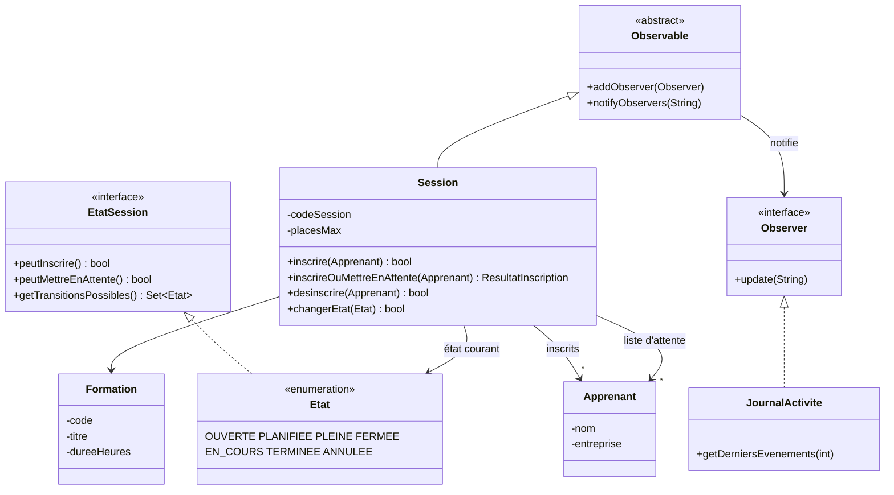

# Formation Management

Application de bureau Java pour gérer un **organisme de formation** : catalogue de formations, sessions, inscriptions des apprenants avec **liste d'attente**, formateurs, statistiques et attestations.

Projet réalisé pour mettre en pratique l'architecture **MVC** et les **design patterns** (Singleton, Factory, State, Observer).

## Fonctionnalités

- **Formations** : catalogue (code, titre, durée, options), création rapide par type (Java, Web, Data) via une fabrique
- **Sessions** : session programmée d'une formation avec un nombre de places, un taux de remplissage et un cycle de vie contrôlé
- **Inscriptions** : inscription et désinscription des apprenants
- **Liste d'attente** : quand une session est pleine, l'apprenant est mis en attente ; si une place se libère, le premier de la liste est **inscrit automatiquement**
- **Journal d'activité** : historique des inscriptions, mises en attente et changements d'état, visible dans les notifications
- **Tableau de bord** : indicateurs et graphiques (barres et camembert)
- **Alertes** : sessions presque pleines ou sans inscrits
- **Exports** et **attestations** de formation
- **Sauvegarde** automatique à la fermeture et rechargement au démarrage

## Design patterns

| Pattern | Où | Rôle |
|---|---|---|
| **Singleton** | `Manager`, repositories, `JournalActivite` | Une seule source de données partagée par toute l'application |
| **Factory** | `FactoryFormation` | Crée une formation pré-remplie selon son type (Java, Web, Data) |
| **State** | `Etat` implémente `EtatSession` | Chaque état décide si l'on peut s'inscrire et vers quels états passer |
| **Observer** | `Session` est `Observable`, `JournalActivite` est `Observer` | Chaque événement d'une session est notifié et historisé |

### Cycle de vie d'une session (pattern State)



Règles appliquées par l'état courant :
- l'inscription directe n'est possible qu'en **Ouverte** ou **Planifiée** ;
- la mise en **liste d'attente** n'est possible qu'en **Pleine** ;
- **Terminée** et **Annulée** sont définitifs ;
- l'interface ne propose que les transitions autorisées depuis l'état courant.

### Diagramme de classes (modèle)



## Architecture

```
src/com/formation/mvc/
  model/
    metier/      Formation, Session, Apprenant, Formateur, Etat
    patterns/    Manager (Singleton), FactoryFormation, Observable, Observer, EtatSession
    repository/  FormationRepository, SessionRepository
    service/     statistiques, exports, notifications, journal, persistance
  controller/    contrôleurs MVC
  view/          MainGUI (interface JavaFX) et vues console
test/            tests unitaires JUnit 5
```

**Persistance** : toutes les données sont sérialisées dans un seul fichier, `data/donnees.dat`, pour conserver les liens entre objets (un apprenant inscrit à une session reste le même objet après rechargement).

## Tests

Les règles métier sont couvertes par des tests **JUnit 5** (`test/.../SessionTest.java`) :
- inscriptions, doublons et passage automatique en « Pleine » ;
- liste d'attente et promotion automatique après une désinscription ou un ajout de places ;
- transitions d'état autorisées et interdites (pattern State) ;
- notifications envoyées aux observateurs (pattern Observer).

```bat
run-tests.bat
```

Le lanceur JUnit est téléchargé automatiquement dans `lib\` au premier lancement.

## Installation

Prérequis : **JDK 21** et le **SDK JavaFX 21** ([téléchargement](https://gluonhq.com/products/javafx/)).

```bat
set JAVAFX_HOME=C:\chemin\vers\javafx-sdk-21
run.bat
```

## Stack technique

Java 21 · JavaFX · JUnit 5 · sérialisation Java

## Auteur

Amine CHIBOUB · [LinkedIn](https://www.linkedin.com/in/mohamed-amine-chiboub/) · [GitHub](https://github.com/AmineCHIBOUB)
